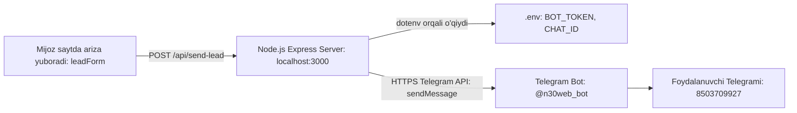

# Telegram Bot orqali Lead/Arizalarni qabul qilish: Brainstorm & Discovery Notes
- **Date**: 2026-10-15
- **Status**: Completed & Verified ✅
- **Goal**: Saytdagi "Bepul konsultatsiyaga yozilish" (`#leadForm`) formasidan tushgan arizalarni xavfsiz tarzda `.env` fayldagi token va chat_id orqali Telegram botga jo'natish tizimini qurish.

---

## 📌 Executive Summary & Key Decisions
*(Yakuniy qabul qilingan qarorlar va holat)*

- **Bot Holati**: `@n30web_bot` (n30 web bot) muvaffaqiyatli ulandi va test xabari yetkazildi.
- **Arxitektura**: Node.js + Express (`server.js`) + `dotenv`.
- **Xavfsizlik**: `TELEGRAM_BOT_TOKEN` va `TELEGRAM_CHAT_ID` to'liq `.env` faylida saqlanmoqda, `.gitignore` orqali himoyalangan.
- **API Endpoint**: `POST /api/send-lead` — kelgan arizalarni qabul qiladi, validatsiya qiladi va Telegram Bot API orqali HTML formatida chiroyli xabar qilib botga yuboradi.
- **Frontend**: `assets/js/main.js` dagi ariza formasi `/api/send-lead` ga ulangan, yuklanish animatsiyasi va muvaffaqiyat modali bilan to'liq ishlamoqda.
- **Server holati**: `http://localhost:3000` manzilida faol ishlab turibdi.

---

## 💬 Test Natijalari

1. **Bot tekshiruvi (getMe)**: `BOT_VERIFIED: @n30web_bot (n30 web bot)` ✅
2. **Xabar yuborish testi**: `SEND_RESULT: true` ✅
3. **Saytdagi ariza testi (/api/send-lead)**: `success: true, message: "Arizangiz muvaffaqiyatli qabul qilindi va mutaxassislarimizga yuborildi!"` ✅

---

## 🚩 Ochiq savollar va keyingi qadamlar (Open Flags)
- [x] Node.js Express serverini sozlash va `dotenv` o'rnatish
- [x] `.env.example` va `.env` fayllarini yaratish
- [x] `.gitignore` fayliga `.env` ni kiritish
- [x] `server.js` da `/api/send-lead` Telegram integratsiyasini yozish
- [x] `assets/js/main.js` da formani API ga ulash va sinovdan o'tkazish
- [x] Bot va serverni to'liq ishga tushirib test qilish
